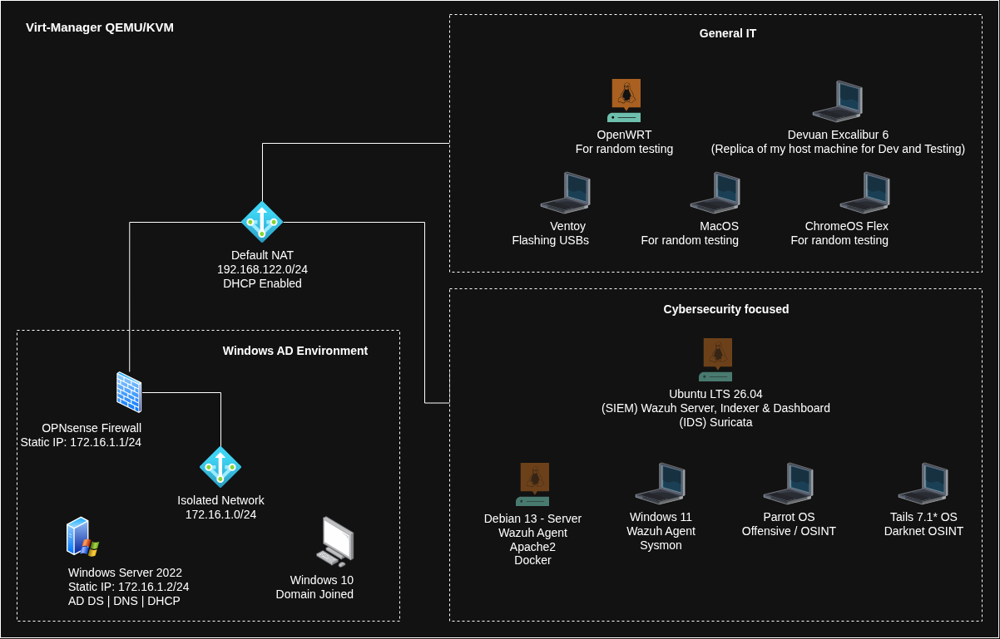

  My current homelab runs entirely under Virt-Manager with QEMU/KVM and is built around a deliberate separation between a controlled Windows domain environment and a flexible testing zone.

  On the left sits an isolated network (<code>172.16.1.0/24</code>). At its core is a Windows Server 2022 domain controller (<code>winsrv.lab</code>) with a static IP of <code>172.16.1.2</code>, acting as both AD DS and DNS. It hands out DHCP leases in the <code>.100–.254</code> range and forwards unresolved queries upstream through the gateway. A domain-joined Windows 10 client lives on the same segment for day-to-day AD and Group Policy work.

  Traffic between this private zone and the outside world is mediated by an OPNsense firewall (<code>172.16.1.1</code>). DHCP is disabled on the LAN side so the Windows Server remains authoritative. Unbound runs as the recursive resolver, with a specific forwarding rule for the <code>winsrv.lab</code> domain and upstream resolvers pointed at Cloudflare and Google (<code>1.1.1.1</code> / <code>8.8.8.8</code>).

  On to the right of, sits on the default libvirt NAT network (<code>192.168.122.0/24</code>), I have the regular IT related machines to test/break/build and is intentionally disposable.  I have also a separate section for Cybersecurity focused homelab for learning how to set things from the ground up and how to assess/respond to alert, as well as refining telemetry. That segment hosts a rotating set of test machines and tools:

<ul style="color: var(--text-muted); margin-bottom: 1rem; padding-left: 1.4rem;">
  <li>Parrot OS for offensive, defensive, and OSINT work.</li>
  <li>Tails (configured with a Tor bridge) for darknet investigation.</li>
  <li>Windows 11 with Sysmon installed for enriched telemetry and Wazuh agent for monitoring.</li>
  <li>Headless Debian 13 with Apache2 server and Docker, Wazuh agent installed for monitoring.</li>
  <li>Ubuntu LTS with Wazuh server (indexer + dashboard) as an SIEM/XDR and Suricata for IDS/IPS capability.</li>
  <li>OpenWRT for router firmware and networking experiments.</li>
  <li>Devuan Excalibur 6, duplicate of my host machine where I things before applying it to my machine.</li>
  <li>Ventoy for when I need to flash a USB thumb drive with it.</li>
  <li>And finally, MacOS and ChromeOS instances for general client-side testing</li>
</ul>

  The design keeps the production-like Windows domain clean and predictable while giving me a sandbox full of different operating systems and network tools that I can break, rebuild, or reconfigure without consequence. It’s a practical balance between stability for identity and DNS work and maximum freedom for everything else.

